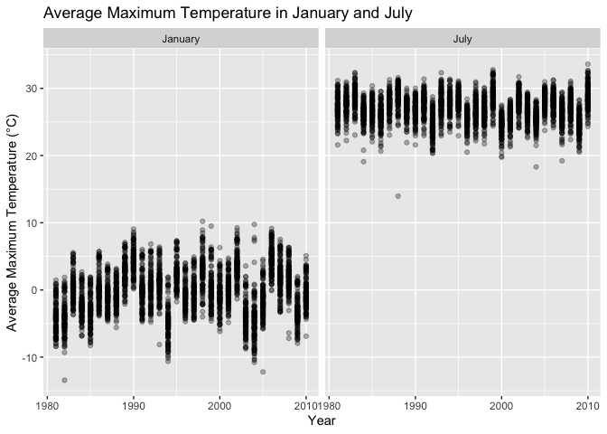
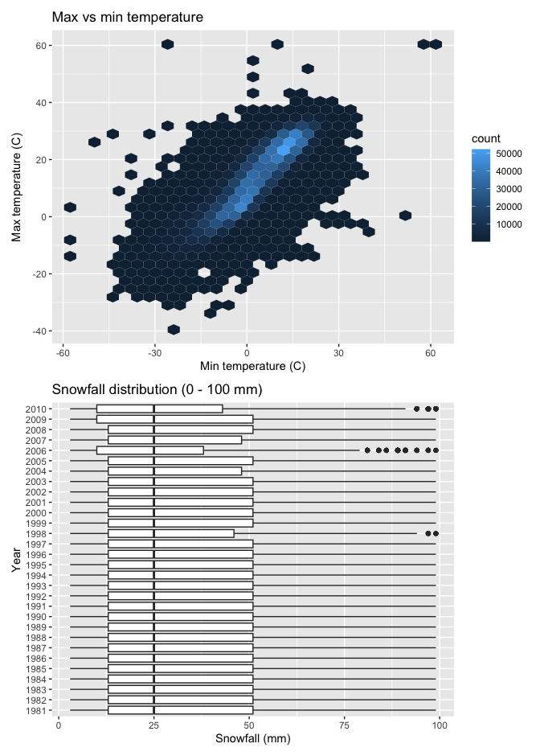
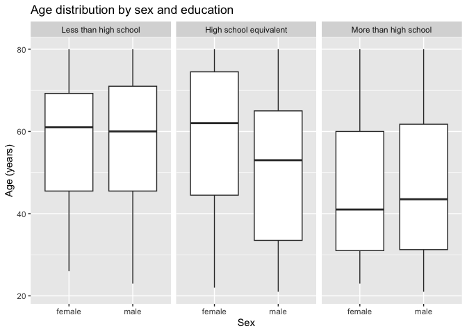
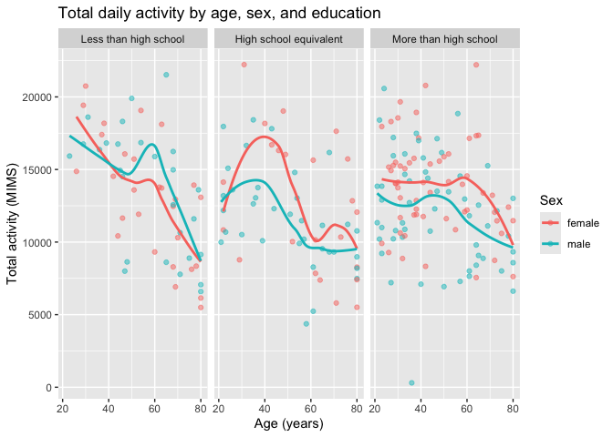
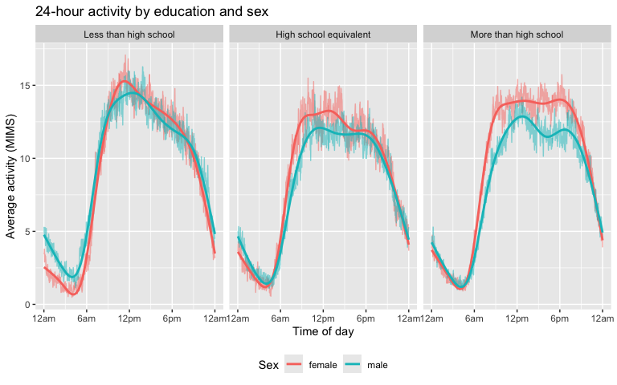

Homework 3
================
Ananya Lahiri
2026-10-21

# Problem 1

``` r
library(tidyverse)
library(p8105.datasets)
library(patchwork)

data("ny_noaa")
head(ny_noaa)
```

    ## # A tibble: 6 × 7
    ##   id          date        prcp  snow  snwd tmax  tmin 
    ##   <chr>       <date>     <int> <int> <int> <chr> <chr>
    ## 1 US1NYAB0001 2007-11-01    NA    NA    NA <NA>  <NA> 
    ## 2 US1NYAB0001 2007-11-02    NA    NA    NA <NA>  <NA> 
    ## 3 US1NYAB0001 2007-11-03    NA    NA    NA <NA>  <NA> 
    ## 4 US1NYAB0001 2007-11-04    NA    NA    NA <NA>  <NA> 
    ## 5 US1NYAB0001 2007-11-05    NA    NA    NA <NA>  <NA> 
    ## 6 US1NYAB0001 2007-11-06    NA    NA    NA <NA>  <NA>

``` r
nrow(ny_noaa)
```

    ## [1] 2595176

``` r
ncol(ny_noaa)
```

    ## [1] 7

``` r
# Explore dataset
ny_noaa |>
summarize(
missing_prcp = sum(is.na(prcp)),
missing_snow = sum(is.na(snow)),
missing_snwd = sum(is.na(snwd)),
missing_tmax = sum(is.na(tmax)),
missing_tmin = sum(is.na(tmin))
)
```

    ## # A tibble: 1 × 5
    ##   missing_prcp missing_snow missing_snwd missing_tmax missing_tmin
    ##          <int>        <int>        <int>        <int>        <int>
    ## 1       145838       381221       591786      1134358      1134420

``` r
# Clean Data
ny_noaa_clean = ny_noaa |>
separate(date, into = c("year", "month", "day"), sep = "-") |>
mutate(
year = as.numeric(year),
month = as.numeric(month),
day = as.numeric(day),
tmax = as.numeric(tmax) / 10,
tmin = as.numeric(tmin) / 10,
prcp = prcp / 10
)

head(ny_noaa_clean)
```

    ## # A tibble: 6 × 9
    ##   id           year month   day  prcp  snow  snwd  tmax  tmin
    ##   <chr>       <dbl> <dbl> <dbl> <dbl> <int> <int> <dbl> <dbl>
    ## 1 US1NYAB0001  2007    11     1    NA    NA    NA    NA    NA
    ## 2 US1NYAB0001  2007    11     2    NA    NA    NA    NA    NA
    ## 3 US1NYAB0001  2007    11     3    NA    NA    NA    NA    NA
    ## 4 US1NYAB0001  2007    11     4    NA    NA    NA    NA    NA
    ## 5 US1NYAB0001  2007    11     5    NA    NA    NA    NA    NA
    ## 6 US1NYAB0001  2007    11     6    NA    NA    NA    NA    NA

The NY NOAA dataset has 2,595,176 observations and 7 variables. These
variables include ID, date, precipitation, snow, snow depth, and maximum
and minimum temperature. Multiple variables have missing values, making
it a strong issue. The number of missing values for each variable are
145,838 for precipitation, 381,221 for snowfall, 591,786 for snow depth,
1,134,358 for maximum temperature, and 1,134,420 for minimum
temperature.

Separate() was used to split the date variable into year, month, and
day, and as.numeric() was used to convert them to numeric variables.
Maximum and minimum temperature were recorded in tenths of a degree
Celsius, so mutate() was used to convert them to numeric and divide them
by 10 so they would be in degrees Celsius. Precipitation was also
divided by 10 since it was recorded in tenths of a millimeter. Snowfall
and snow depth were already in millimeters, so they did not need to be
changed.

``` r
# Most commonly observed snowfall values
ny_noaa_clean |>
group_by(snow) |>
summarize(count = n()) |>
arrange(desc(count))
```

    ## # A tibble: 282 × 2
    ##     snow   count
    ##    <int>   <int>
    ##  1     0 2008508
    ##  2    NA  381221
    ##  3    25   31022
    ##  4    13   23095
    ##  5    51   18274
    ##  6    76   10173
    ##  7     8    9962
    ##  8     5    9748
    ##  9    38    9197
    ## 10     3    8790
    ## # ℹ 272 more rows

The most commonly observed value for snowfall was 0 mm, with 2,008,508
observations. This is probably because most days do not have snowfall
since it only happens a few days a year in NY. There were also 381,221
missing values. Other values that were commonly observed include 25 mm,
13 mm, 51 mm, and 76 mm. Since they are around 1, 0.5, 2, and 3 inches,
snowfall was maybe measured in inches and then converted to millimeters.

``` r
# Average max temp in January and July
ny_noaa_temp = ny_noaa_clean |>
filter(month == 1 | month == 7) |>
mutate(month = case_match(month, 1 ~ "January", 7 ~ "July")) |>
group_by(id, year, month) |>
summarize(mean_tmax = mean(tmax, na.rm = TRUE))
```

    ## Warning: There was 1 warning in `mutate()`.
    ## ℹ In argument: `month = case_match(month, 1 ~ "January", 7 ~ "July")`.
    ## Caused by warning:
    ## ! `case_match()` was deprecated in dplyr 1.2.0.
    ## ℹ Please use `recode_values()` instead.

``` r
# Two-panel plot with average max temp
ny_noaa_temp |>
drop_na(mean_tmax) |>
ggplot(aes(x = year, y = mean_tmax)) +
geom_point(alpha = 0.3) +
facet_grid(. ~ month) +
labs(
x = "Year",
y = "Average Maximum Temperature (°C)",
title = "Average Maximum Temperature in January and July")
```

<!-- -->

The average maximum temperature is lower in January when compared to
July. In January, temperatures are typically around -5°C to 5°C.
However, in July, temperatures are around 25°C to 30°C. There is no
clear trend in temperatures across years, they seem stable. In addition,
there are a few outliers with lower than normal temperatures in both
January and July.

``` r
# tmax vs tmin for the full dataset
ggp_tmax_tmin = ny_noaa_clean |>
ggplot(aes(x = tmin, y = tmax)) +
geom_hex() +
labs(
title = "Max vs min temperature",
x = "Min temperature (C)",
y = "Max temperature (C)"
)

# Snowfall distribution between 0 - 100 mm
ggp_snow = ny_noaa_clean |>
filter(snow > 0, snow < 100) |>
mutate(year = as.factor(year)) |>
ggplot(aes(x = snow, y = year)) +
geom_boxplot() +
labs(
title = "Snowfall distribution (0 - 100 mm)",
x = "Snowfall (mm)",
y = "Year"
)

# Combine plots
ggp_tmax_tmin / ggp_snow
```

<!-- -->

Geom_hex() was used since there were too many observations for a
scatterplot to be readable. Maximum and minimum temperature had a
positive relationship, so days with higher minimum temperatures also had
higher maximum temperatures. Most observations were between about -10°C
and 15°C for minimum temperature and 0°C and 30°C for maximum
temperature. There were a few outliers, like temperatures around 60°C
and -60°C, which could have been data errors. Geom_boxplot() was used to
show snowfall between 0 and 100 mm for each year. The distribution was
similar across the years, with a median of around 25 mm.

# Problem 2

``` r
# Demographic data
nhanes_covar = read_csv("data/nhanes_covar.csv", skip = 4, na = c("NA", ".", "")) |>
janitor::clean_names() |>
filter(age >= 21) |>
drop_na() |>
mutate(
sex = case_match(sex, 1 ~ "male", 2 ~ "female"),
sex = factor(sex),
education = case_match(education,
1 ~ "Less than high school",
2 ~ "High school equivalent",
3 ~ "More than high school"),
education = factor(education, levels = c("Less than high school", "High school equivalent", "More than high school"))
)
```

    ## Rows: 250 Columns: 5
    ## ── Column specification ────────────────────────────────────────────────────────
    ## Delimiter: ","
    ## dbl (5): SEQN, sex, age, BMI, education
    ## 
    ## ℹ Use `spec()` to retrieve the full column specification for this data.
    ## ℹ Specify the column types or set `show_col_types = FALSE` to quiet this message.

``` r
# Accelerometer data
nhanes_accel = read_csv("data/nhanes_accel.csv") |>
janitor::clean_names() |>
pivot_longer(min1:min1440, names_to = "minute", names_prefix = "min", values_to = "mims") |>
mutate(minute = as.numeric(minute))
```

    ## Rows: 250 Columns: 1441
    ## ── Column specification ────────────────────────────────────────────────────────
    ## Delimiter: ","
    ## dbl (1441): SEQN, min1, min2, min3, min4, min5, min6, min7, min8, min9, min1...
    ## 
    ## ℹ Use `spec()` to retrieve the full column specification for this data.
    ## ℹ Specify the column types or set `show_col_types = FALSE` to quiet this message.

``` r
# Merge
nhanes_df = left_join(nhanes_covar, nhanes_accel, by = "seqn")

head(nhanes_df)
```

    ## # A tibble: 6 × 7
    ##    seqn sex     age   bmi education              minute  mims
    ##   <dbl> <fct> <dbl> <dbl> <fct>                   <dbl> <dbl>
    ## 1 62161 male     22  23.3 High school equivalent      1 1.11 
    ## 2 62161 male     22  23.3 High school equivalent      2 3.12 
    ## 3 62161 male     22  23.3 High school equivalent      3 1.47 
    ## 4 62161 male     22  23.3 High school equivalent      4 0.938
    ## 5 62161 male     22  23.3 High school equivalent      5 1.60 
    ## 6 62161 male     22  23.3 High school equivalent      6 0.145

The first 4 rows of the demographic data were skipped since they had
descriptions of the variables. Participants under 21 and those with
missing demographic data were removed using filter() and drop_na().
Case_match() and factor() were used to make sex and education
categorical, and education was ordered as less than high school, high
school equivalent, and more than high school so it would show in that
order in tables and plots instead of alphabetical order. Pivot_longer()
was used to change the 1,440 minute columns into rows, so each
participant had one row for each minute of the day with the activity
value for that minute. Left_join() was used to merge the datasets by
participant ID. The final dataset had 228 participants and 328320 rows.

``` r
# Number of men and women in each education category
nhanes_covar |>
count(education, sex) |>
pivot_wider(names_from = sex, values_from = n) |>
knitr::kable()
```

| education              | female | male |
|:-----------------------|-------:|-----:|
| Less than high school  |     28 |   27 |
| High school equivalent |     23 |   35 |
| More than high school  |     59 |   56 |

``` r
# Age distribution for men and women in each education category
nhanes_covar |>
ggplot(aes(x = sex, y = age)) +
geom_boxplot() +
facet_grid(. ~ education) +
labs(
title 

= "Age distribution by sex and education",
x = "Sex",
y = "Age (years)"
)
```

<!-- -->
Count(), pivot_wider(), and knitr::kable() were used to make a table of
the number of men and women in each education category. Most
participants were in the “More than high school” category, with 59 women
and 56 men. The “Less than high school” category had a similar number of
women and men (28 and 27), but the “High school equivalent” category had
more men than women (35 and 23). Geom_boxplot() and facet_grid() were
used to show the age distribution for men and women in each education
category. Participants in the “More than high school” category were
younger than the other two categories, with median ages of around 40
years. In the “Less than high school” category, men and women had
similar ages, with median ages of around 60 years. In the “High school
equivalent” category, women were older than men, with a median age of
approximately 62 compared to approximately 53 years.

``` r
# Total activity for each participant
nhanes_df |>
group_by(seqn, sex, age, education) |>
summarize(total_activity = sum(mims)) |>
ggplot(aes(x = age, y = total_activity, color = sex)) +
geom_point(alpha = .5) +
geom_smooth(se = FALSE) +
facet_grid(. ~ education) +
labs(
title = "Total daily activity by age, sex, and education",
x = "Age (years)",
y = "Total activity (MIMS)",
color = "Sex"
)
```

<!-- -->

Group_by() and summarize() were used to add up the activity across all
the minutes for each participant. Geom_smooth() was used to add the
trend lines, and facet_grid() was used to make a separate panel for each
education category. Across all three categories, total activity
decreased as age increased. In the “High school equivalent” and “More
than high school” categories, women were more active than men at most
ages. In the “Less than high school” category, women were more active
than men at younger ages, but men were more active than women between
the ages of 50 and 60 years old.

``` r
# Average activity at each minute of the day
nhanes_df |>
group_by(education, sex, minute) |>
summarize(mean_mims = mean(mims)) |>
ggplot(aes(x = minute, y = mean_mims, color = sex)) +
geom_line(alpha = .5) +
geom_smooth(se = FALSE) +
facet_grid(. ~ education) +
scale_x_continuous(
breaks = c(0, 360, 720, 1080, 1440),
labels = c("12am", "6am", "12pm", "6pm", "12am")) +
labs(
title = "24-hour activity by education and sex",
x = "Time of day",
y = "Average activity (MIMS)",
color = "Sex"
) +
theme(legend.position = "bottom")
```

<!-- -->

Group_by() and summarize() were used to find the average activity at
each minute of the day for men and women in each education category, and
geom_smooth() was used to add trend lines. In all three categories,
activity was lowest overnight from approximately 4 to 5am, and then
increased quickly in the morning. It stayed high during the day, and
decreased in the evening. In the “Less than high school” category,
activity peaked around noon and then slowly decreased, and men and women
had similar activity levels. In the “High school equivalent” and “More
than high school” categories, women were more active than men during the
day, and this difference was largest in the “More than high school”
category. People in the “More than high school” category also stayed
active later on into the evening.
